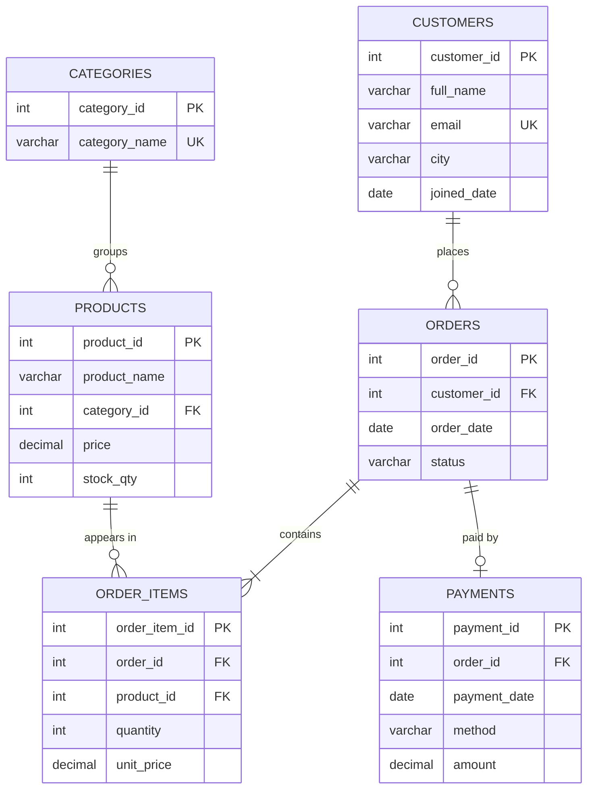

# E-Commerce Order Management System (SQL)

A relational database project built in **pure SQL (MySQL)** that models an online store: customers, products, orders, order items, and payments. It includes sample data and 15 analytical queries for sales reporting.


---

## Objectives

- Design a normalized relational schema (3NF) with proper keys and constraints
- Load realistic sample data
- Answer business questions using joins, subqueries, CTEs, and window functions
- Create reusable views and indexes for reporting and performance

---

## Tech Stack

| Item     | Detail                              |
|----------|-------------------------------------|
| Database | MySQL 8.0+                          |
| Language | SQL (DDL, DML, DQL)                 |
| Tool     | MySQL Workbench (or any SQL client) |

---

## ER Diagram




---

## Database Schema

| Table         | Purpose                                | Key Constraints                                    |
|---------------|----------------------------------------|----------------------------------------------------|
| `customers`   | Customer details                       | PK `customer_id`, UNIQUE `email`                   |
| `categories`  | Product categories                     | PK `category_id`, UNIQUE `category_name`           |
| `products`    | Product catalog and stock              | FK `category_id`, CHECK `price > 0`, `stock_qty >= 0` |
| `orders`      | Order header                           | FK `customer_id`, CHECK on `status`                |
| `order_items` | Line items of each order               | FK `order_id`, FK `product_id`, CHECK `quantity > 0` |
| `payments`    | Payment per order (one-to-one)         | UNIQUE `order_id`, CHECK on `method`               |

**Order status values:** Placed, Shipped, Delivered, Cancelled
**Payment methods:** UPI, Card, NetBanking, COD

---

## Views and Indexes

| Object               | Type  | Description                                  |
|----------------------|-------|----------------------------------------------|
| `vw_order_totals`    | View  | Total amount per order                       |
| `vw_product_sales`   | View  | Units sold and revenue per product           |
| `idx_orders_customer`| Index | Speeds up customer-wise order lookups        |
| `idx_orders_date`    | Index | Speeds up date-range reports                 |
| `idx_items_product`  | Index | Speeds up product-wise sales queries         |

---

## Analysis Queries

| #   | Business Question                              | Concepts Used                  |
|-----|------------------------------------------------|--------------------------------|
| Q1  | Total revenue (excluding cancelled)            | Aggregation, View              |
| Q2  | Monthly revenue trend                          | GROUP BY, DATE_FORMAT          |
| Q3  | Top 5 customers by spend                       | JOIN, ORDER BY, LIMIT          |
| Q4  | Best-selling products                          | View, ORDER BY                 |
| Q5  | Revenue share by category (%)                  | Window function `SUM() OVER`   |
| Q6  | Customers who never ordered                    | LEFT JOIN, IS NULL             |
| Q7  | Products never sold                            | Subquery, NOT IN               |
| Q8  | Orders above average order value               | Subquery                       |
| Q9  | Customer rank within each city                 | CTE, `RANK() OVER`             |
| Q10 | Repeat customers                               | GROUP BY, HAVING               |
| Q11 | Payment method usage                           | Aggregation                    |
| Q12 | Order status breakdown                         | GROUP BY                       |
| Q13 | Low-stock products                             | Filtering                      |
| Q14 | Month-over-month revenue growth                | CTE, `LAG()`                   |
| Q15 | Payments not matching order totals (data check)| JOIN, validation               |

---

## How to Run

1. Install MySQL 8.0+ and MySQL Workbench.
2. Clone this repository:
   ```bash
   git clone [https://github.com/nadargeAnkita/ecommerce-order-management-sql.git](https://github.com/nadargeAnkita/E-Commerce-Order-Management-System-.git)
   cd E_Comm_Analysis.sql
   ```
3. Open `E_Comm_Analysis.sql` in MySQL Workbench.
4. Run the full script. It will:
   - create the `ecommerce_db` database
   - create all tables, indexes, and views
   - insert the sample data
5. Run the queries from the **Analysis Queries** section one at a time to see results.

---

## Project Structure

```
├── E_Comm_Analysis.sql              # Schema, data, views, queries
├── er_diagram.png                   # ER diagram image
└── README.md
```

---

## Key Learnings

- Designing a normalized schema with one-to-many and one-to-one relationships
- Enforcing data integrity using constraints
- Writing readable analytical SQL with CTEs and window functions
- Using views to simplify repeated logic

---

## Future Enhancements

- Add customer addresses, discounts, and product reviews tables
- Connect to Power BI for a sales dashboard
- Add a returns/refunds table

---

## Author

**Ankita Nadarge**
[LinkedIn](https://www.linkedin.com/in/ankita-nadarge/) | [GitHub](https://github.com/nadargeAnkita)
